<p align="center">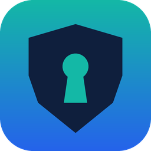</p>

<h1 align="center">LLM Vault</h1>

<p align="center">
  <b>AI agents use your models. They never see your API keys.</b><br>
  A KeePass-compatible password manager with a built-in, policy-enforcing LLM gateway.<br>
  One native desktop app · open source · works with Claude Code, GitHub Copilot, Ollama and 30+ providers.
</p>

<p align="center">
  <a href="https://bestin-it.com/llm-vault/"></a>
  <a href="LICENSE"></a>
  <a href="https://github.com/bestin-it/llm-vault/actions/workflows/ci.yml"></a>
  
  
</p>

<p align="center">
  <a href="https://bestin-it.com/llm-vault/"><b>Download</b></a> ·
  <a href="#video-guides"><b>Videos</b></a> ·
  <a href="#guides-on-bestin-itcom"><b>Guides</b></a> ·
  <a href="#quick-start"><b>Quick start</b></a> ·
  <a href="#security-model"><b>Security model</b></a>
</p>

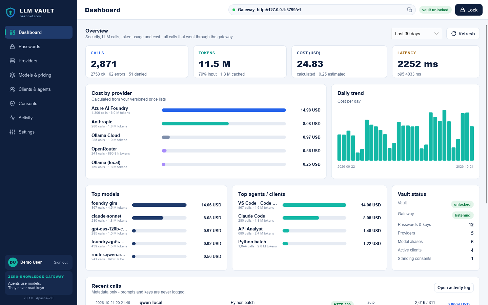

## Why

A coding agent reads files, environment variables and tool output, and it runs commands. If your OpenAI,
Azure AI Foundry or Anthropic key sits in `.env`, one prompt injection hidden in a README is enough to send
it to a stranger. Hiding the file does not help: whatever you can read, your agent can read.

LLM Vault changes the model from `get_secret()` to `invoke_model()`. The key stays in an encrypted
KeePass-compatible vault, and the vault makes the call itself. Each agent, IDE or script gets a **client token**
instead: a revocable permission to call the models you allowed, within a budget, with your approval.

> "Use my permission to run an approved operation - but never show me the secret."

## Video guides

Real recordings of the app, real HTTP responses, local models. Click a thumbnail to watch.

<!-- videos:start -->
<table>
<tr><td width="33%" valign="top"><a href="https://youtu.be/WYxzj_zIJUs">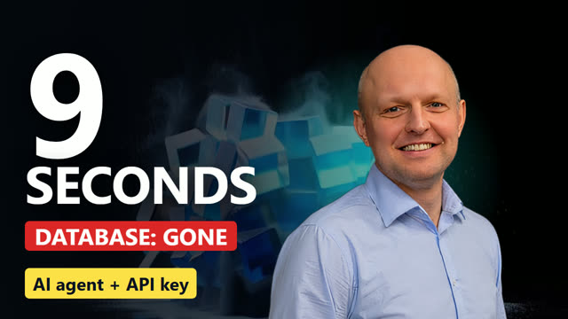</a><br><sub><b>Nine seconds: why my AI agents never see my API keys</b> · 1:25</sub></td><td width="33%" valign="top"><a href="https://bestin-it.com/vscode-copilot-custom-endpoint/">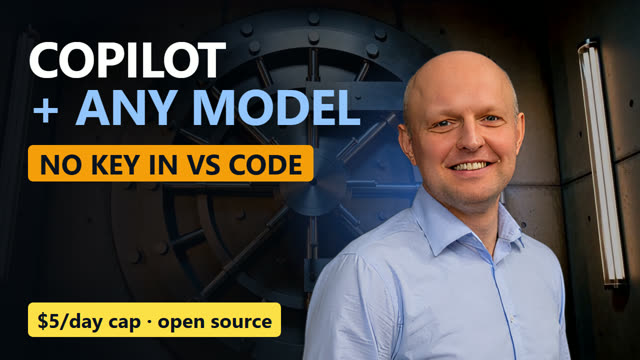</a><br><sub><b>Copilot, meet the vault: any model in VS Code, no key in the editor</b> · 1:01</sub></td><td width="33%" valign="top"><a href="https://bestin-it.com/local-llm-gateway-ollama-lm-studio-llama-cpp/">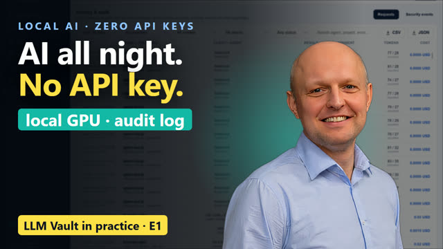</a><br><sub><b>E1 · A Python script that runs AI all night - with no API key</b> · 0:52</sub></td></tr>
<tr><td width="33%" valign="top"><a href="https://bestin-it.com/local-llm-gateway-ollama-lm-studio-llama-cpp/">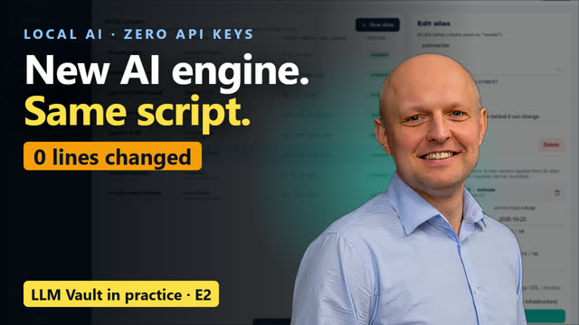</a><br><sub><b>E2 · Ollama → llama.cpp without changing a line of code</b> · 0:46</sub></td><td width="33%" valign="top"><a href="https://bestin-it.com/local-llm-gateway-ollama-lm-studio-llama-cpp/">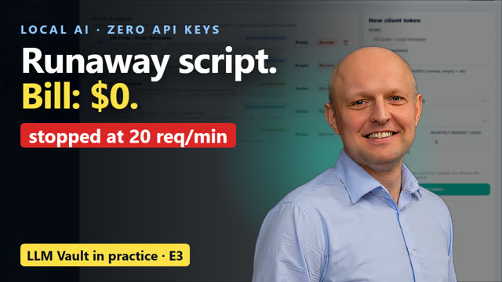</a><br><sub><b>E3 · An infinite retry loop vs. an AI API bill</b> · 0:49</sub></td><td width="33%" valign="top"><a href="https://bestin-it.com/llm-vault/">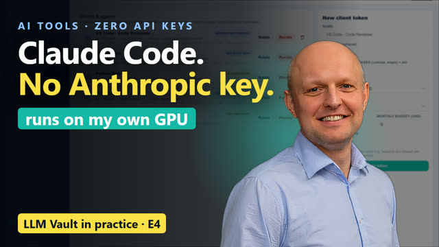</a><br><sub><b>E4 · Claude Code on a local model - no Anthropic key</b> · 0:42</sub></td></tr>
<tr><td width="33%" valign="top"><a href="https://bestin-it.com/ai-agent-api-key-security/">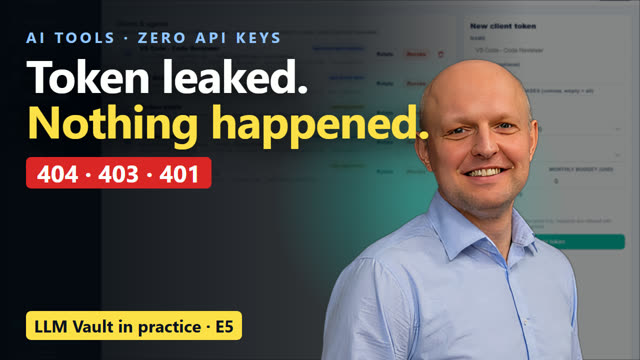</a><br><sub><b>E5 · I leaked my AI agent's token on purpose</b> · 0:36</sub></td><td width="33%" valign="top"><a href="https://bestin-it.com/llm-vault/">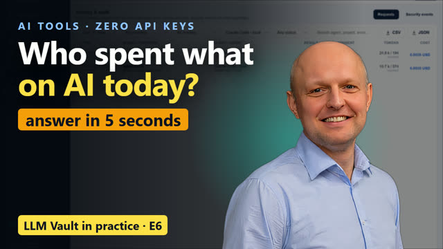</a><br><sub><b>E6 · One audit log for every AI tool on your machine</b> · 0:36</sub></td></tr>
</table>

**Shorts:** [My AI agent asked for my API key. Politely.](https://youtu.be/HGoFO1RWY1M)

**Playlists:** [LLM Vault - AI agents without API keys](https://www.youtube.com/playlist?list=PLey0tug_UaH8)

Subscribe on YouTube: https://www.youtube.com/@bestin-it

<!-- videos:end -->

## Features

| | |
|---|---|
| 🔐 **Password manager** | KDBX 4.1 vault (AES-256, Argon2id 64 MiB, ChaCha20-protected fields, HMAC block integrity). Groups, logins, notes, password generator, clipboard auto-clear. Opens your KeePass / KeePassXC databases, and its files open in them. |
| 🚪 **LLM gateway** | `127.0.0.1:8765`: OpenAI `/v1/chat/completions` (streaming, tool calls), Anthropic `/v1/messages` (Claude Code), `/v1/embeddings`, `/v1/models`. **No endpoint returns a key, a password or the configuration.** |
| 🧩 **38 integrations** | Ollama (local + ollama.com), LM Studio, llama.cpp, vLLM, SGLang, OpenAI, Azure AI Foundry, Azure OpenAI, Anthropic, Gemini, OpenRouter, Groq, Mistral, DeepSeek, xAI and more - with model discovery and local server detection. |
| 🎫 **Client tokens** | Per client: model allow-list, expiry, requests/minute, daily and monthly budget, one-click revoke. Stored as SHA-256 only. |
| ✋ **Consent** | Ask every time, once per session, or pre-approve - with an anti-click-jacking arming delay on the buttons. |
| 📊 **Audit & analytics** | Every call with its policy decision, tokens (input / output / cached), cost and latency. Usage is labelled *reported*, *estimated* or *unavailable*. CSV / JSON export. |
| 👤 **Profiles** | Sign in with a user name and login password; several profiles per machine, each with its own vaults, audit log and settings. No password reset - by design. |
| 🖥️ **Desktop-first** | One native executable (Rust + Slint). No Docker, no browser, no Python or Node runtime. `llmvault-server` runs the same gateway headless for the strong-isolation mode. |

## How it works

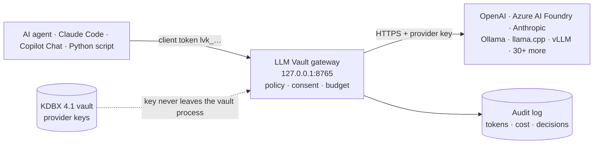

1. The client sends a normal OpenAI- or Anthropic-style request with its token.
2. LLM Vault checks the token, the model allow-list, limits and budgets, and asks you if the policy says so.
3. The vault calls the provider with the key - the key exists only inside the vault process and the TLS request.
4. The client gets the answer; tokens, cost and the decision go to the audit log.

## Download

| Platform | Package | Where |
|---|---|---|
| Windows 10 1809+ / 11 (x64) | Installer (per-user, no admin) · portable ZIP · SHA-256 checksums | **[bestin-it.com/llm-vault](https://bestin-it.com/llm-vault/)** |
| macOS · Linux | Build from source (below); DMG, AppImage, .deb and .rpm scripts are in `packaging/` | - |

Installers are published on the project page only, not as GitHub release assets.
Try it without any key: `llmvault --demo` opens an isolated vault with synthetic data.

## Quick start

1. Install, create a profile, then create a vault (or open an existing `.kdbx`).
2. **Providers** - connect e.g. *Ollama (local)* (no key) or *Azure AI Foundry* (the key goes into the vault).
3. **Clients & agents** - create a token per agent, IDE or script. It is shown once, with ready snippets.
4. Point the client at the vault:

```python
# Python - OpenAI SDK: only the base URL and the "key" change
import os
from openai import OpenAI
client = OpenAI(base_url="http://127.0.0.1:8765/v1", api_key=os.environ["VAULT_CLIENT_TOKEN"])
print(client.chat.completions.create(model="qwen-local",
      messages=[{"role": "user", "content": "Review this diff"}]).choices[0].message.content)
```

```powershell
# Claude Code - Anthropic Messages API on /v1/messages
$env:ANTHROPIC_BASE_URL   = "http://127.0.0.1:8765"
$env:ANTHROPIC_AUTH_TOKEN = "lvk_..."        # vault token, not an Anthropic key
$env:ANTHROPIC_MODEL      = "qwen-local"     # alias defined in LLM Vault
claude
```

More: [VS Code GitHub Copilot Chat (Custom Endpoint)](examples/vscode/README.md) ·
[Claude Code](examples/claude-code.md) · [Python](examples/python) · [curl](examples/curl.md) ·
[custom Copilot agent](examples/.github/agents/code-reviewer.agent.md) ·
[scripts from the videos](examples/use-cases)

## Guides on bestin-it.com

| Guide | What you get | Category |
|---|---|---|
| [**LLM Vault - download & overview**](https://bestin-it.com/llm-vault/) | Installers, features, setup in five minutes, FAQ | [AI Tools & Automation](https://bestin-it.com/category/ai-tools/) |
| [AI agent API key security: let agents use models without seeing the key](https://bestin-it.com/ai-agent-api-key-security/) | The threat, the `invoke_model()` design, 24 probes / 0 leaks, limits | [AI Tools & Automation](https://bestin-it.com/category/ai-tools/) |
| [VS Code Copilot custom endpoint: route Copilot Chat through LLM Vault](https://bestin-it.com/vscode-copilot-custom-endpoint/) | `chatLanguageModels.json`, agent mode, tool calls, budgets | [Software Development & Tools](https://bestin-it.com/category/tools/) |
| [Local LLM gateway for Ollama, LM Studio and llama.cpp](https://bestin-it.com/local-llm-gateway-ollama-lm-studio-llama-cpp/) | 7-42 ms measured overhead, streaming, local token costs, reasoning-model pitfalls | [Local AI & LLMs](https://bestin-it.com/category/ai/) |
| [KeePass compatible password manager in Rust](https://bestin-it.com/keepass-compatible-password-manager-rust/) | KDBX 4.1, Argon2id settings, 0.33 s unlock, config inside the encrypted file | [Software Development & Tools](https://bestin-it.com/category/tools/) |

## Security model

| Threat | Status |
|---|---|
| Agent reads the provider key from config, responses or logs | **Prevented** - the key never leaves the vault process except inside the TLS request to the provider |
| Prompt injection asks to "show the secret" | **Contained** - there is no such operation; calls still pass policy and consent |
| Abuse of paid models | **Limited** - allow-lists, consent, budgets, rate limits, expiry |
| Stolen client token | **Limited** - minimal scope, expiry, instant revocation |
| Malware / agent with code execution as the same OS user | **Not solved by a desktop app** - run `llmvault-server` on a separate VM, OS account or device |

Running the vault under the same OS account as a terminal-capable agent is a convenience mode, not hard isolation.
The full threat model and the requirements are in [`docs/requirements.html`](docs/requirements.html);
measured numbers in [`docs/measurements.md`](docs/measurements.md). Found a vulnerability? See [SECURITY.md](SECURITY.md).

## Build from source

```bash
cargo run -- --demo                     # try it with synthetic data
cargo test                              # unit + security integration tests (mock provider)
cargo test --test live_local -- --ignored --nocapture   # against local Ollama / llama.cpp / LM Studio
cargo build --release                   # target/release/llmvault(.exe) + llmvault-server(.exe)

packaging/windows/build-windows.ps1     # Inno Setup installer + portable ZIP
packaging/macos/build-macos.sh          # .app + DMG (signing / notarization via env vars)
packaging/linux/build-linux.sh          # AppImage + .deb + .rpm
```

Linux build dependencies: `libfontconfig1-dev libxkbcommon-dev libwayland-dev libx11-dev`.

<details>
<summary><b>Project layout</b></summary>

| Path | What |
|---|---|
| `src/vault.rs` | KDBX 4.1 vault: create / open, atomic save + `.bak`, groups, entries, generator, provider keys |
| `src/gateway.rs` | axum gateway: the only network surface (`/health`, `/v1/*`), browser-origin rejection |
| `src/providers/` | 38 integrations, request building, egress policy (HTTPS only, no redirects), OpenAI ⇄ Anthropic translation |
| `src/policy.rs` · `src/core.rs` | client tokens, consent, budgets, rate limits, lock / auto-lock |
| `src/audit.rs` · `src/pricing.rs` | SQLite audit log, analytics, versioned price lists, CSV / JSON export |
| `src/redact.rs` | key redaction in every error and log line |
| `src/profiles.rs` | user profiles (Argon2id login), one data directory per profile |
| `src/ui.rs` · `ui/*.slint` | native desktop UI (Slint) |
| `src/bin/llmvault-server.rs` | headless gateway for the strong-isolation mode |
| `tests/security.rs` | security acceptance tests: 24 secret probes, 401/403/404/423/429 paths, redaction |
| `examples/` | Python, curl, Claude Code, VS Code Copilot and the scripts from the videos |
| `packaging/` | Windows (Inno Setup), macOS (DMG), Linux (AppImage / deb / rpm) |

</details>

## Contributing

Issues and pull requests are welcome - provider presets, client snippets, fixes, docs.
Read [CONTRIBUTING.md](CONTRIBUTING.md) first; report security issues privately ([SECURITY.md](SECURITY.md)).
Changes per version: [CHANGELOG.md](CHANGELOG.md).

## Author

**Artur Poniedziałek** · [bestin-it.com](https://bestin-it.com) - hands-on articles on local AI, AI tools and
developer security · [X @bestin_it](https://twitter.com/bestin_it) ·
[LinkedIn](https://www.linkedin.com/in/artur-poniedzia%C5%82ek-73897297)

If LLM Vault keeps a key out of an agent's reach, a ⭐ helps other developers find it.

## License

Apache-2.0 © bestin-it.com - see [LICENSE](LICENSE). Third-party components: [THIRD-PARTY.md](THIRD-PARTY.md).
UI made with [Slint](https://slint.dev).
